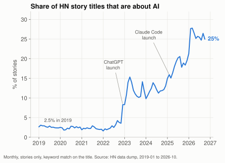
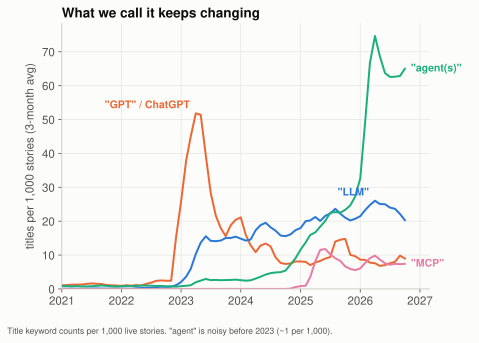
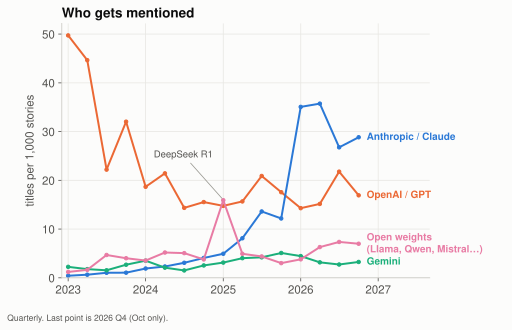
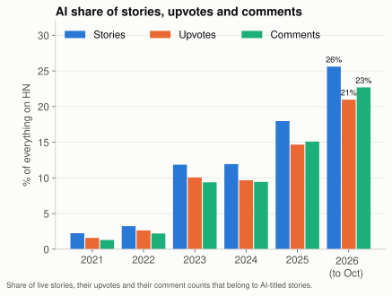

This week I revived my [Hacker News dataset](/notebook/hn-data-exploration/). It is every story and comment from 2007 until this week, about 50 million rows, as monthly Parquet files that DuckDB can query directly. Having it fresh again, I wanted to ask one simple question.

How did the conversation about AI actually change?

Not "is AI big", that one is obvious. I mean what people talk about, who they talk about, and how they feel about it. Hacker News is a decent microscope for this. It is a developer crowd, it is very online, and it reacts to everything within hours.

So here is what 7 years of story titles say.

## It is one in four stories now

First the boring number. I counted a story as "about AI" if its title matches a list of keywords (AI, LLM, GPT, OpenAI, Anthropic, Claude, Gemini, agents, MCP, Llama, DeepSeek and some more, full list at the bottom).



It is not one smooth wave. It looks like three steps:

1. **2019 to late 2022: flat at ~2.5%.** Machine learning was a normal topic, like databases or Rust.
2. **ChatGPT, December 2022.** The share jumps from 4% to 15% in four months. After that it settles around 10-14% for the whole of 2023 and 2024. That is the first plateau.
3. **2025 and 2026: it never stops climbing.** Claude Code shows up in February 2025 and the line mostly goes up from there. Then in early 2026 it takes another jump, 21% in January to 28% in February. It has stayed at 25-27% since.

If you only count the 30 most upvoted stories of each month, it is even more. That number was 0.8% in 2019, 14% in 2023, and **29% on average in 2026**. In May 2026 it was 40%.

I did not expect the second jump. After ChatGPT I assumed the hype would cool down and the share would come back to a stable level. It did the opposite.

## The word changed: GPT, then LLM, then agent

What I find more interesting than the size is the vocabulary. If I count a few specific words in titles, each one has its own era.



- **"GPT" / ChatGPT** peaked in March 2023, at 62 titles per 1,000 stories. About 1 in 16 stories had it. Today it is under 7.
- **"LLM"** is the calmer, more technical word. It grew slowly through 2023 and 2024, and peaked in February 2026 (27 per 1,000). Now it is slowly declining.
- **"Agent(s)"** was background noise until 2024. Then it grows through 2025 and explodes in early 2026. In March 2026 it was in **80 of every 1,000 stories**, more than GPT's peak. It is still around 69 today.
- **"MCP"** is the little hump. It appears in early 2025, peaks in April 2025 (15 per 1,000) and then goes quiet. Protocols are quiet by nature, I guess. Once everyone just uses it, nobody writes a title about it.

To me this reads like the focus moved up one layer each time. First people talked about *the model* (what can GPT do). Then about *the model as a component* (LLM, how do I use it). Now it is about *the thing built around the model*: the loop, the tools, the permissions, the harness. The word "agent" really is about the system, not about the weights.

I see the same shift in my own habits, I spend more time comparing agents like Claude Code and OpenCode than comparing models. But I don't think the model became unimportant. The harness is where the talk moved, the model is still half of the result (see the next section).

If you only look at coding tools (Claude Code, Cursor, Copilot, Codex, OpenCode and a few others), the matching titles went from ~900 in 2024 to ~3,200 in 2025 to **8,400 in the first ten months of 2026**. And "vibe coding" came and went as a term: 946 titles in 2025, but it is already fading in 2026.

## Who gets talked about

The same count by company tells a pretty dramatic story.



- In early 2023, OpenAI/GPT titles were the entire AI conversation. 50 per 1,000 stories. Anthropic was 0.5.
- OpenAI fell fast, then settled into a band of roughly 14-22 per 1,000 from 2024 (the quarter of the Altman firing excepted).
- Anthropic/Claude grew steadily through 2024 and 2025, caught up with OpenAI around December 2025, and then jumped in Q1 2026 to 35 per 1,000. That is more than twice OpenAI in the same quarter (14).
- Open-weight models have a rhythm of spikes. The pink spike in Q1 2025 is DeepSeek.
- Gemini is surprisingly flat. It is always there, never the main topic.

This is also why I don't buy "the model is a commodity". If it were, nobody would argue about whose name is in the title.

Two caveats. HN is not "the market", and a developer crowd will naturally love whatever is the best coding tool this quarter. Also "Claude" includes Claude Code, which is probably most of the 2026 jump. So read this chart as "mindshare among programmers", not as market share.

But still, the leader changed within three years, and it was not slow. I wonder what this chart looks like next year.

## AI posts get a little less love per post

Here is something I did not expect.



For every year, AI is a bigger share of the *stories* than of the *upvotes*, and the comments sit in between. In 2026: 26% of stories, 21% of upvotes, 23% of comments.

The average AI-related story scores 15.7 points in 2026, while the average other story scores 20.2. That gap is not new, it was the same in 2019 (10.7 vs 15.8). So the readers did not get tired of AI specifically. It is more that AI is the topic everybody wants to submit. One hint: 19% of AI-titled stories in 2026 are "Show HN" (people showing what they built), against 12% of the other stories. Show HN posts also score a bit lower on average (13.9 vs 15.0 points since 2015).

The attention is not evenly spread though. A few threads take most of it. Here are the biggest AI stories in the dataset by score:

| Points | Story | Date |
|---:|---|---|
| 5,710 | OpenAI's board has fired Sam Altman | Nov&nbsp;2023 |
| 4,229 | Don't post generated/AI-edited comments. HN is for conversation between humans | Mar&nbsp;2026 |
| 4,091 | GPT-4 | Mar&nbsp;2023 |
| 3,346 | Show HN: Gemini Pro 3 imagines the HN front page 10 years from now | Dec&nbsp;2025 |
| 3,138 | GPT-4o | May&nbsp;2024 |
| 2,932 | Astra can read and write weights to improve Qwen | Nov&nbsp;2026 |
| 2,905 | GitHub Copilot | Jun&nbsp;2021 |
| 2,626 | Claude Fable 5 | Jun&nbsp;2026 |
| 2,455 | Google "We have no moat, and neither does OpenAI" | May&nbsp;2023 |
| 2,445 | Claude Code is steganographically marking requests | Jun&nbsp;2026 |

My favourite here is the second row. A rule about *not posting AI-generated comments*, from the site itself, is the second most upvoted AI story in this dataset. And it is from this year.

## The mood changed too

The tone moved from "wow" to "how do I live with this". A few words that show it:

| Keyword in title | 2023 | 2024 | 2025 | 2026 (to Oct) |
|---|---:|---:|---:|---:|
| slop | 0 | 35 | 318 | 827 |
| bubble | 146 | 180 | 477 | 290 |
| hallucinat* | 188 | 221 | 281 | 341 |

"Slop" went from nothing to 827 titles this year. The big stories of 2023 were mostly launches (*"GPT-4"*, *"Llama 2"*). The big ones of 2026 also include "An AI agent published a hit piece on me" (2,346 points), "I believe there are entire companies right now under AI psychosis" (2,105), and in 2025 "My AI skeptic friends are all nuts" (2,356).

And the last 3 months have a clear new theme: **the tools themselves became the attack surface**.

- A backdoor in a Claude Code extension on the Cursor marketplace
- OpenCode user credentials leaked
- Postman silently auto-installing AI plugins that try to share all your API data

That makes sense. When the thing is an agent that can run commands, read your files and has your credentials, the security question stops being theoretical. Everything I said about the focus moving to the harness has a flip side: the harness is where things break.

Meanwhile the money part is getting loud as well. In the last 3 months the big stories included Nvidia acquiring Hugging Face, an Anthropic S-1 filing (with 1,681 comments, and a counter thread arguing the SEC should block it), and a House resolution against an "AI bubble bailout".

## What I take from this

1. **The conversation moved to the harness, but the model still matters just as much.** The talk shifted to the loop around it: tools, context, permissions, review. Yet the vendor chart says people still care about *whose* model it is. Each lab curates data and trains in its own flavour, and that shows in how an agent behaves, even with the same harness. The catch is distillation. Open-weight models are trained on outputs of the big ones, so the flavours blur, and the gap between a frontier model and an open one keeps getting harder to see from the outside. I treat the model and the harness as two halves of one product, and I would not judge either alone.
2. **Mindshare is fickle.** OpenAI was 50 per 1,000 stories in 2023 and about 17 now. Anthropic went from 0.5 to a peak of 35. If the leader can change in three years, designing a system that can swap the model without drama is not over-engineering, it is basic hygiene.
3. **Growth and fatigue happen at the same time.** AI is 25% of all stories and "slop" is also at an all-time high. Both are true. I think it means the easy part (impressive demo) is cheap now, and the hard part (trust, correctness, security) is what people start to care about.

## How I did this, and what is wrong with it

All the data is the public dataset at `hacker-news.adhikasp.my.id`, and the query is a plain DuckDB regex over the title:

```sql
SELECT strftime(time, '%Y-%m') AS month,
       count(*) AS stories,
       sum(regexp_matches(lower(title),
         '\bai\b|\bllms?\b|\bgpt|chatgpt|openai|anthropic|claude|gemini|copilot|'
         || '\bagents?\b|agentic|\bmcp\b|deepseek|qwen|mistral|llama|'
         || 'machine learning|neural|diffusion|transformer|large language|generative'
       )::int) AS ai_stories
FROM read_parquet('year=*/month=*/data.parquet', hive_partitioning = true)
WHERE type = 'story' AND title IS NOT NULL
GROUP BY 1 ORDER BY 1;
```

Things to keep in mind when reading the charts:

- **Keyword matching is crude.** "agent" also matches things like user agents or real estate agents, and "copilot", "transformer" or "cursor" can be about something else. I checked the baseline: before 2023 these words appear about 1 in 1,000 titles, so the 2026 numbers are far above the noise, but the exact percentages are rough.
- **Only titles, only stories.** A comment about AI under a non-AI story does not count.
- **HN is not the world.** It is a small developer crowd with strong opinions.
- I dropped stories flagged as dead or deleted, and I left out November 2026 because it is not finished. The attention chart (stories vs upvotes vs comments) counts only the story's own score and total comment count.

It is a fun dataset. Next I want to try the comments, to see whether the tone toward AI (not just the topic) changes over time.
